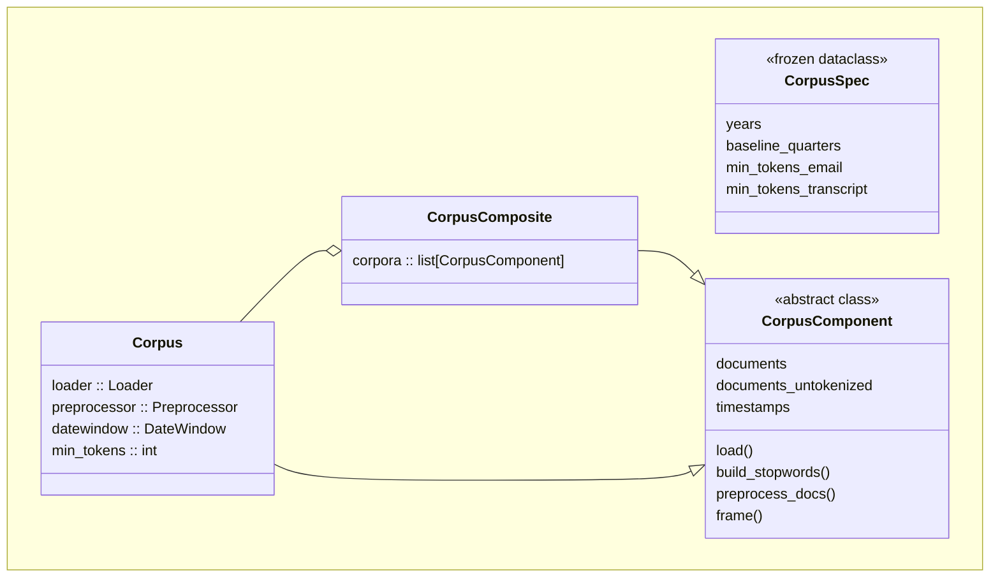
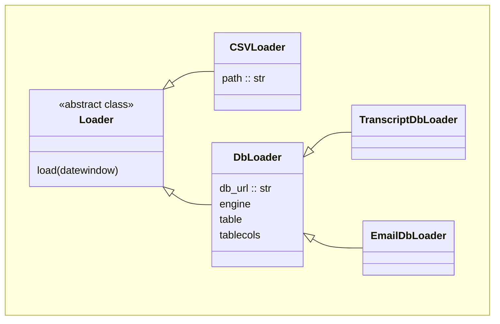
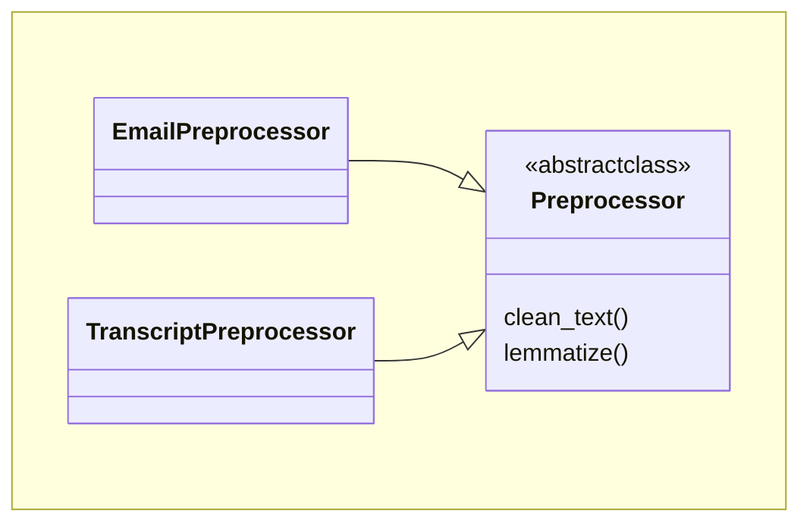
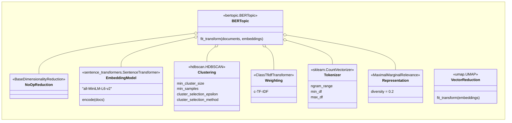

# Email Topic Modeling Pipeline

A Python pipeline for discovering and visualizing trending topics from email
data using **BERTopic**
with outputs including an interactive Excel workbook,
topic heatmaps, and per-topic word clouds.

## Table of Contents

- [Overview](#overview)
- [Requirements](#requirements)
- [Installation](#installation)
- [Configuration](#configuration)
- [Usage](#usage)
- [Outputs](#outputs)
- [Corpora](#corpora)
    - [Loading Corpora](#loading-corpora)
- [Preprocessing](#preprocessing)
- [Topic Modeling](#training-the-model)
    - [Document Embeddings](#document-embeddings)
    - [Emedding Reduction](#embedding-reduction)
    - [Clustering](#clustering)
    - [Topic Representation](#topic-representation)
    - [BERTopic](#bertopic)
- [Visualizations](#visualizations)
    - [topic_counts](#topic_counts)
    - [timeviz](#timeviz)
- [mlflow](#mlflow)
    - [Authentication](#authentication)
- [Maintenance](#maintenance)

---

## Overview

This pipeline ingests documents from the Development\\InvestementResearch
database (or, optionally, a CSV export; this was originally the case during
development).
The documents are cleaned, tokenized, and lemmatized, and those documents
are passed to a BERTopic model to identify salient topics.

---

## Requirements

Dependencies are defined in `pyproject.toml`

---

## Installation

1. Clone the repository
```bash
git clone //davis.local/it/repos/davis-investment-topic-model
cd davis-investment-topic-model
```

2. Install Python venv

If Python 3.14+ is installed on system, create a virtual environment in the
directory in which DITM will be hosted:

```bash
python -m venv .venv
```

3. Install package

This will also install dependencies as defined in `pyproject.toml`.
External (internet) connectivity is required for this step.

```bash
./.venv/Scripts/python -m pip install --group dev --editable .
```

4. Install the `SentenceTransformers` model to `models/` by extracting
`all-MiniLM-L6-v2.zip` into the calling script's directory
(the location is specified in `config.py` as `EMBEDDING_MODEL`).  
The `.zip` is available in the Project Sharepoint, obtained from
[sbert.net/models](sbert.net/models).  

---

## Configuration

* Local configuration is held in `src/ditm/config.py`

* Parameters for model components, including the default time range for
data query (in years) is held in `src/ditm/params.py`

* Sensitive configuration is held in `.env`; as of writing, this includes only
the database path and an unused path to a csv testing file.

---

## Usage

Running main from the project directory:

```bash
./.venv/Scripts/python -m ditm
```

For parameter sweeping:

```bash
./.venv/Scripts/python -m ditm.flow
```

### Logging
The log destination file is defined in `config.py`, in `src/logs`.

Any entry script or REPL calls must load the logging setup and define a
`logger` as below.

```python
import logging
from ditm.logs import setup_logging
logger = logging.getLogger(__name__)
```

---

## Outputs

The main `pipeline()` function outputs a tuple of two objects:

 - `artifactpaths: dict` Dictionary of {artifactname : Path} for objects generated and saved at the Path:

   - 'topic_info' : Csv of `BERTopic`'s topic_info, showing representation of topics and doc count per topic  
   - 'topic_sizes' : Html bar graph of topic counts, including on-hover representation
   - 'timeviz_{baseline}' : Html heatmap of topics over time, both for rolling and growing baselines
   - 'corpus_data' : Complete corpus data in CSV (to be changed to Parquet), including ContentId, doc index per source-document, lemmatized text, cleaned unlemmatized text. This may be instrumental in later, Streamlit-driven visualizations (alternatively, this could be placed in a database).

---

## Corpora

The corpus consitutes the aggregate of all source document corpora.

The values returned by these properties are held in `Corpus._data`,
a `pd.DataFrame` that uses the database `ContentId` as its index.
Thus, `ContentID` is retained for any purpose that may require mapping
to a doc's source.

To retrieve the data, including an index to the original source text,
call `Corpus.frame()`.

### Loading Corpora

Corpora are organized into a Composite design pattern that allows individual
corpus sources to be fetched according to their storage location
and processed according to their content.

`CorpusComponent` is an abstract class that defines the requirements of
`Corpus`, which treats individual corpora, and `CorpusComposite`,
which contains and iterates through multiple `Corpus` objects.



Thus multiple data sources can be maintained separately yet treated as a single
`CorpusComposite` object.

`CorpusComposite` is declared with a list of `Corpus` instantiations:

```python
from ditm import Corpus, EmailDbLoader, EmailPreprocessor
corpus = CorpusComposite([
    Corpus(
        loader = EmailDbLoader(),
        preprocessor = EmailPreprocessor(),
        datewindow = DateWindow(),
        min_tokens = CorpusSpec().min_tokens_email,
    ),
    Corpus(
        loader = TranscriptDbLoader(),
        preprocessor = TranscriptPreprocessor(),
        datewindow = DateWindow(),
        min_tokens = CorpusSpec().min_tokens_transcript,
    )
])
```

A single call to the `.load()` method retrieves the data for each, as
defined in their respective `Loader`:

```python
corpus.load()
```

Aside: `Loader` includes an option to write an export to the database;
however, because repeat documents must be pulled on each run, this would
result in a very large number of records (one per ContentId for each run),
and thus is diabled via `DbLoader._log_export: bool`.
To enable writing to `ContentExports`, set this to `True`
(or change the default in `DbLoader`):

```python
for c in corpus:
    c.loader._log_export = True
corpus.load() # now writes to database
```

`Loader`s are structured to be flexible with regard to their data source,
allowing for varied database tables or different databases.
The `CSVLoader` subclass allows for importing data from a local file, which
was instrumental in early development.



## Prepocessing

Preprocessing of multiple `Corpus` objects works in the same way as loading;
a single call to `CorpusComposite.preprocess_docs()` iterates through each
`Corpus`.

```python
corpus.preprocess_docs()
```

Each `Corpus` calls the pipeline defined in `Preprocessor`,
which cleans the text of formatting and tokenizes/lemmatizes the cleaned text.  
Following this step, `corpus.documents` and `corpus.timestamps` can be used for
the topic model ([below](#training-the-model)).

`Preprocessor` is an abstract class that specifies the requirement for
`.clean_text()`, which defines the specific cleaning process for each data
source, e.g. the process to clean the formatting of emails is defined
in `EmailPreprocessor.clean_text()` and the process to clean the formatting of
transcript files is defined in `TranscriptPreprocessor.clean_text()`.

Processors for other document source types may be arbitrarily added.



Note that lemmatization process is (and likely should be) the same for all
corpora, so this is defined once in `Preprocessor.lemmatize()`
and inhereted by all `Preprocessor` subclasses.

The output of preprocessing is held in `Corpus._data`, which contains both the
lemmatized forms and the orginal (cleaned) documents, again using the database
`ContentId` as the index.


## Training the Model

`BERTopic` is designed to be modular, in the interest of flexibility for
any given use case.
In DITM, component models are first defined and declared, then used in
the creation of the model.

The DITM model makes specifications for the following components:

| Component | Model |
| --- | --- |
| Embedding model | SentenceTransformers 'all-MiniLM-L6-v2' |
| Dimensionality reduction | UMAP |
| Clustering | HDBSCAN |
| Vectorizer | CountVectorizer |
| cTfIdf | ClassTfidfTransformer |
| Representation model | MaximalMarginalRelevance |



### Document Embeddings

`BERTopic`'s recommended embedding model `all-MiniLM-L6-v2` has proven
sufficient for Davis' topic model. See [Installation](#installation)
for installation thereof.


```python
from sentence_transformers import SentenceTransformer
embedding_model = SentenceTransformer(str(config.EMBEDDING_MODEL.resolve()))
```

`BERTopic` recommends generating document embeddings before creating the
model, then passing the reduced embeddings directly; this is reportedly more
computationally performant than passing the documents themselves.

```python
embeddings = embedding_model.encode(inputs = list(corpus.documents))
```

### Embedding Reduction

`all-MiniLM-L6-v2` generates embeddings of 384 dimensions.
To mitigate the
[Curse of Dimensionality](https://en.wikipedia.org/wiki/Curse_of_dimensionality),
which adversely affects clustering, that dimensionality is reduced.
The target dimensionality is a hyperparameter that can be modified;
reducing to 5 dimensions has performed reasonably.

UMAP is the default reduction model used by BERTopic.
DITM defines the parameters explicitly in `ditm.params`.

**There is unlikely to be motivation to change these UMAP parameters.**

Notably, setting the `init` parameter to `"pca"` mitigated,
without a loss in performance, a memory-capacity issue from the default
`"spectral"` low-dimension initialization.

### Clustering

The core of the topic model, clustering groups of semantically-related
documents together.

The default clustering algorithm used in `BERTopic` is HDBSCAN
(Hierarchical Density-Based Spatial Clustering of Applications with Noise).
The embeddings represent the meaning of each document as points or
Euclidean vectors in *n*-dimensional space (n=5). A common metric for measuring
similarity of meaning is to measure cosine similarity of those vectors.

**HDBSCAN is the most likely place where parameters may be adjusted.**

HDBSCAN parameters are defined in `ditm.params`; each is described:

| | |
|---|---|
| | |
| min_cluster_size | Higher: keeps topics large |
| min_samples | Higher: more points discarded as noise, but may cause memory errors |
| cluster_selection_epsilon | At 0, no clusters are merged; setting higher creates more general topics |
| cluster_selection_method | `"leaf"` keeps smaller, specific clusters; `"eom"` results in large, general topics  |
| prediction_data | Set to `False`; `True` calculates unused probabilities |
| core_dist_n_jobs | CPU count, not included in `HdbscanParams` but set in `pipline` to use the server's number of CPU cores minus 1 |

#### `min_samples`

Keeping `min_samples` low is critical to preventing memory errors.

### Topic Representation

#### CountVectorizer

The "vectorizer" component has no direct effect on the topic clusters,
but feeds into c-Tf-Idf to determine which words characterize each topic.
`VectorizerParams` is defined in `ditm.params`.

`max_df` is a threshold to exclude highly-frequent words. At `.3`, words that
appear in 30% of documents are ignored. This likely has no effect unless set
lower, but runs the risk of excluding important words.

```python
@dataclass(frozen = True)
class VectorizerParams():
    ngram_range: Tuple[int, int] = (1, 2)
    min_df: int                  = 2
    max_df: float                = .3
```

#### cTfIdf Model

c-Tf-Idf is a modification of Tf-Idf, identifying the words that
characterize each topic. `ClassTfidfTransformer` is `BERTopic`'s default, but
is declared explicitly in `pipeline()` in order to specify
`reduce_frequent_words` to reduce the impact of highly-frequent words.

#### Representation Model

The Representation Model affects only how topics are presented;
it does not affect clustering. `MaximalMarginalRelevance` is set directly in
the definition of `pipeline()`, where a higher value may result in
less-repetitive topic names.

### BERTopic

#### Instantiating BERTopic

```python
topic_model = BERTopic(
    embedding_model = embedding_model,
    umap_model = BaseDimensionalityReduction(),
    hdbscan_model = hdbscan_model,
    vectorizer_model = vectorizer_model,
    ctfidf_model = ClassTfidfTransformer(reduce_frequent_words = True),
    # Representation only affects displayed topic labels (words)
    representation_model = MaximalMarginalRelevance(diversity = .2),
    calculate_probabilities = False,
    verbose = True,
)
```
### Fitting the model

Note that the direct output of `BERTopic.fit_transform()` is unused.

```python
_, _ = topic_model.fit_transform(
    documents = list(corpus.documents),
    embeddings = reduced_embeddings
)
```

---

## Visualizations

### topic_counts

A simple bar chart representing the number of docs that have been classified
to each topic, sorted by size. 

`ditm.viz.topic_sizes` generates an html plot with on-hover display of each
topic.

### timeviz

`BERTopic`'s native `visualize_topics_over_time`, which represents raw counts,
is not well-suited to the purposes of DITM.

`timeviz` instead leverages a "log-odds" calculation to measure a topic's
prominence in a given period (quarter) relative to its own baseline&mdash;either
its entire previous history in a dataset or a narrower rolling baseline window.  
The approach is adapted from previous work in language processing;
Monroe, Colaresi, and Quinn (2008) used it to quantify a word's prominence
between corpora.

Key parameters are:

| | |
|---|---|
|baseline|"growing" or "rolling"|
|k|Number of baseline periods for a rolling window|
|n_perm|Number of randomized permutations, tested during visualization-generation to ensure that flagged changes are not the result of chance|
|level|Threshold of what is considered chance. Setting this closer to 1 will limit the number of flagged topics, at the risk of excluding false negatives.|
|alpha0|Prevents zeros from breaking the math. No real effect unless set very high, though any effect is untested.|


```python
timechange = viz.topic_changes(
    topic_model.topics_,
    list(corpus.timestamps),
    alpha0 = 500,
    k = corpus_spec.baseline_quarters,
    freq = "Q",
    direction = "both",
    level = .998,
    n_perm = 3000,
    baseline = baseline,
)
words = viz.bertopic_words(topic_model)
timechange.heatmap(words).write_html(timeviz_path)
```

## mlflow

For testing and as a preliminary interface, `ditm` uses `mlflow`.

### Authentication

Starting mlflow ui server:

```bash
sh mlflow.sh
```

The mlflow ui server must be started with an environment variable for
`MLFLOW_FLASK_SERVER_SECRET_KEY` that matches the value when the server was
first run.

On first run, an admin password must also be set.
This is only required for the first run;
however, this is included in `mlflow.sh` as well.

### Adding a user

To add a user, use a browser to access
[http://tuc-web-v06:5000/#/admin](http://tuc-web-v06:5000/#/admin)
and select "Create User".

### Changing a user password

A password can only be changed by the user and can only be done via a REST call;
there is no UI method.


---

## Maintenance

### Hyperparameters

HDBCAN is the primary place where adjustments may be made.
See [Clustering](#clustering) above for a description of parameters.

### min_cluster_size and min_samples

The model has produced reasonable clusters with a high `min_cluster_size` and
low `min_samples`.

If the corpus grows, however, `min_cluster_size` may need to be raised
proportionally, lest topics become too separated.

  - The proportion of `min_cluster_size`/documents is recorded in the `metrics`
  output of `pipeline()`; monitor this for drift.

  - Should topics drift to become very numerous, granular, or split, raise
  `min_cluster_size` based on document count.

  - Similarly, `min_samples` may benefit from a higher value in such a case.

### Errors

Errors&mdash;particularly memory errors&mdash;are captured with the any known
cause specified in the log.

### Adding Corpora

1. Loader --> DbLoader  

To add a Loader, create a new subclass in a new file under
`src/ditm/loaders`. This can be either a subclass of `DbLoader`, which contains
a query to the database using tables defined in `ditm.db.tables` (see below).
For initial testing, a csv-loader can be created as a direct subclass of
`Loader` (note that `CSVLoader` is email-specific). Reference existing loaders
as a guide.

Loaders must define:

 - `_normalize_dataframe()`, which sets 'document' and 'timestamp' columns.
 this method is called by the parent class' `Loader.load()`
 - `content_type` as a class attribute, where possible values are set
 in `ditm.content_type`

DbLoaders must define:

 - `table` as a class attribute. Tables are defined in `ditm.db.tables`.

    - Create a `Table` object in `ditm.db.tables`, including all database table
  fields with their types and any relationships with other tables.

 - `tablecols` as a class attribute. Column lists are defined in `ditm.db.tables`.

    - Create a "Cols" `StrEnum` in `ditm.db.tables` listing only the fields to be queried.

1. Preprocessor  

To add a Preprocessor, create a new subclass in a new file under
`src/ditm/preprocessors`. Preprocessors must define:

 - `.clean_text()`, which strips source-specific formatting and any
 source-specific extraneous text.

 - `content_type` as a class attribute, where possible values are set
 in `ditm.content_type`


### NLP Filters

Stop words may be added to `ditm.nlp_filters.STOPWORDS` in the event that
topic labels are found to contain common words that are not informative.

`ditm.nlp_filters.NER` lists SpaCy NER labels that are excluded before
embedding. These may be changed, as well, though there is no expected motivation
to do so.

